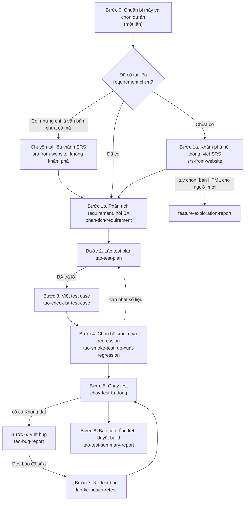

# Bản đồ 11 skill theo quy trình (cho người bảo trì repo)

**Người dùng đọc [bat-dau.md](bat-dau.md)** (hướng dẫn cho người mới: thứ tự công việc, câu nói mẫu, việc tự làm). Trang này chỉ là bản đồ bước → skill → file ra, cho người sửa skill. Thứ tự và câu chữ cho người dùng chỉ viết ở `bat-dau.md` để hai nơi không lệch nhau; đổi quy trình thì sửa `bat-dau.md` trước, rồi sửa sơ đồ và bảng dưới đây nếu bước hoặc skill đổi.

## Tóm tắt một trang

| Bước | Việc | Skill | Ra file chính | Bạn phải làm |
|---|---|---|---|---|
| 0 | Chuẩn bị máy, chọn dự án | (không cần skill) | `.du-an-hien-tai`, `.env` | Cài phần mềm, điền tài khoản test |
| 1a | Khám phá hệ thống chưa có tài liệu, viết SRS | `srs-from-website` | `srs/<dự-án>/<tính-năng>.md` | Trả lời câu hỏi (mật khẩu tài khoản test do Claude tự nhập) |
| 1a+ | (Tùy chọn) báo cáo khám phá HTML cho người mới | `feature-exploration-report` | `evidence/<dự-án>/.../*.html` | Không |
| 1a' | Chuyển tài liệu văn bản thành SRS có mã | `srs-from-website` | `srs/<dự-án>/<tính-năng>.md` | Đưa tài liệu |
| 1b | Phân tích requirement, soạn câu hỏi BA | `phan-tich-requirement` | `bang-soat-requirement.md`, `cau-hoi-cho-ba.md` | **Gửi câu hỏi cho BA**, mang câu trả lời về |
| 2 | Lập test plan gửi sếp (cập nhật số liệu sau bước 4) | `tao-test-plan` | `test-plan.md` + HTML/PDF | **Điền phiếu**: ngưỡng, tên người, ngày |
| 3 | Viết test case | `tao-checklist-test-case` | `test-case.md` | **Duyệt danh sách tình huống** trong chat |
| 4 | Chọn bộ smoke và bộ regression | `tao-smoke-test`, `de-xuat-regression` | `smoke-test.md`, `regression-test.md` | Chốt các case Claude hỏi |
| 5 | Chạy test, ghi kết quả | `chay-test-tu-dong` | trang `*-ket-qua.html` | Nêu địa chỉ môi trường thử, số build |
| 6 | Viết bug | `tao-bug-report` | `bug/BUG-nnn.md` + HTML | Duyệt phần "Giả định", trả lời câu hỏi |
| 7 | Re-test bug đã sửa | `lap-ke-hoach-retest` | `retest/BUG-nnn-ke-hoach.md`, lịch sử trong bug | Cho số build có bản sửa, **chốt Đóng/Mở lại** |
| 8 | Báo cáo tổng kết, duyệt build | `tao-test-summary-report` | `test-summary-report.md` + HTML | **Người duyệt chọn Nhận / Không nhận** trên trang |

Mọi file nằm trong `testing/<dự-án>/` (trừ SRS ở `srs/`, ảnh và nhật ký khám phá ở `evidence/`). **Chỉ cần mở một file: trang tổng `testing/<dự-án>/index.html`.** Trang này có link tới mọi trang của dự án (tài liệu, test case, kết quả chạy, bug, smoke, regression, test plan, báo cáo tổng kết, hướng dẫn). Mỗi lần Claude làm xong, câu trả lời chỉ đưa một link tới đúng phần của trang tổng.

---
